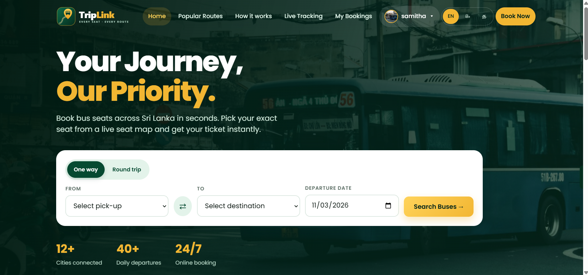
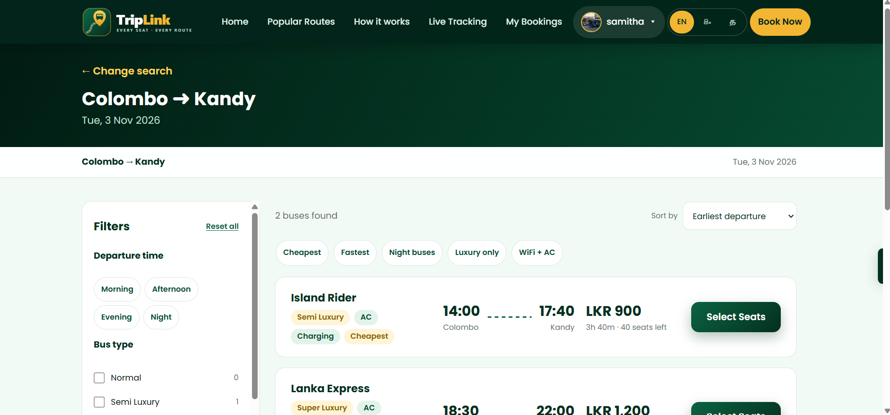
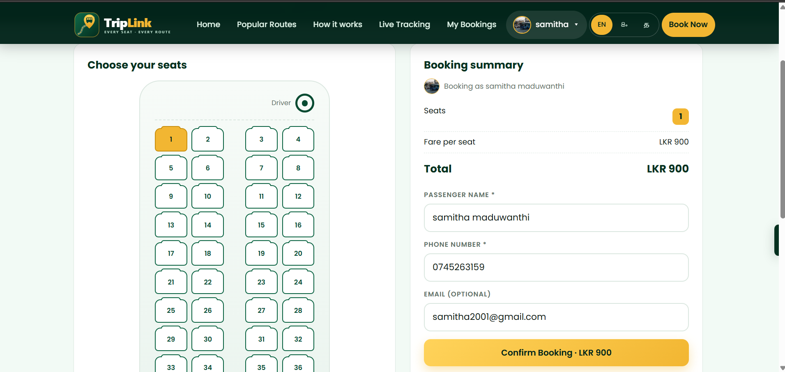
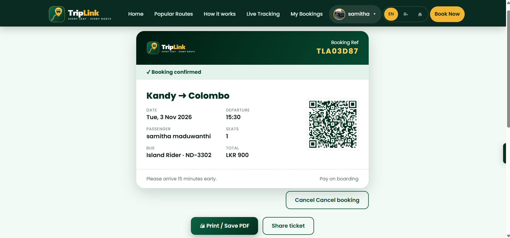
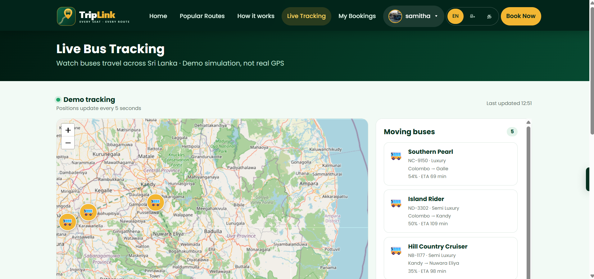
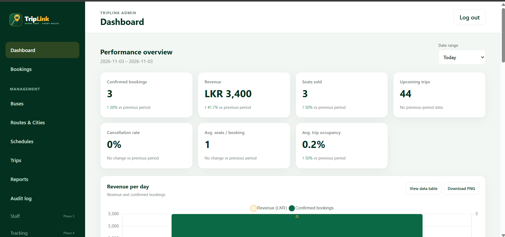
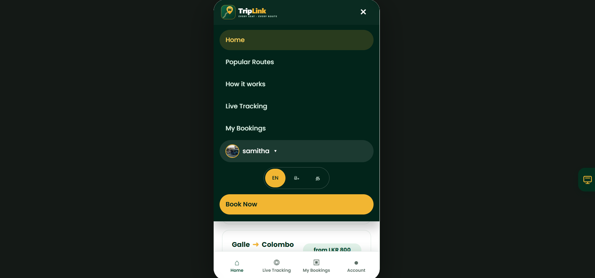

# 🚌 TripLink: Sri Lanka Bus Seat Booking System

> Your journey, our priority. Search routes, pick your exact seat, get a QR e-ticket and track your bus live.

## ✨ Features
- 🔍 Route search with date selection and real-time seat availability
- 💺 Interactive seat map (2+2 layout), up to 6 seats per booking
- 🛡️ Double-booking protection using database constraints and transactions
- 🎫 QR e-ticket with print / save as PDF
- 🔐 Passenger accounts: register, login, booking history, profile photo
- 🔎 Filters and sorting on results (price, time, bus type, amenities)
- 🗺️ Live bus tracking on a Leaflet map
- 🌐 Multi-language: English / සිංහල / தமிழ்
- 📱 Fully responsive mobile and desktop versions
- 🧑‍💼 Admin dashboard with charts, bookings and revenue

## 📸 Screenshots
| Home | Search results |
|------|----------------|
|  |  |

| Seat selection | E-ticket |
|----------------|----------|
|  |  |

| Live tracking | Admin dashboard |
|---------------|-----------------|
|  |  |

| Mobile view |
|-------------|
|  |

## 🛠️ Tech Stack
**Frontend:** React 18 (CDN), HTML5, CSS3, Leaflet
**Backend:** PHP 8 (JSON API, PDO)
**Database:** MySQL
**Tools:** WAMP, VS Code, Git

## 🚀 Getting Started
1. Copy the project to `C:\wamp64\www\triplink`
2. In phpMyAdmin create a database named `triplink_db`, select it and import `database.sql`
3. Run the `database_update_*.sql` files on `triplink_db`
4. Check the database name and admin password in `api/config.php`
5. Open `http://localhost/triplink/`
6. Admin panel: `http://localhost/triplink/admin/`

## 👩‍💻 Author
**Heshanthi Prasangika**
HND in Information Technology, SLIATE ATI Galle
📧 heshanthiprasangika10@gmail.com